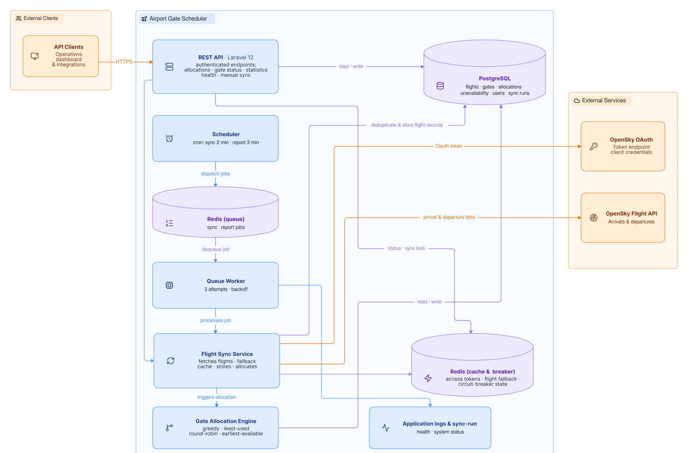

# ✈️ Airport Gate Scheduler

[](https://github.com/Bee7go/gate-scheduler/actions/workflows/ci.yml)

**A production-shaped REST API that ingests live flight data and allocates airport gates — built to show what an API partners can rely on looks like.**

It pulls arrivals and departures from the OpenSky Network, assigns each flight to an available gate using configurable strategies, and exposes a documented, versioned API for allocations, gate status, maintenance windows, and operational statistics.

**[API documentation](docs/API.md)** · **[Versioning policy](docs/API.md#versioning)** · **[Changelog](CHANGELOG.md)** · **[Deployment guide](docs/DEPLOYMENT.md)**

---

## Design Decisions

The interesting part of this project is not the gate allocation — it is the reliability engineering around it.

**Fail closed, never open.** If the database is unreachable, protected endpoints return `503 Service unavailable` — an infrastructure failure can never bypass authentication, on either the API-key or the Bearer-token layer. The scenario is covered by a test that makes the database unreachable and asserts the request is rejected rather than let through.

**Survive a flaky upstream.** OpenSky calls go through retry with backoff, a circuit breaker, and a cached fallback. When live data is unavailable, the sync degrades gracefully instead of failing — and says so: every sync run is recorded as `completed`, `degraded`, or `failed` and exposed via `GET /system/status`.

**One sync at a time, whoever asks.** Flight syncs can be triggered by the scheduler, the queue, the CLI, or the API. A shared cache lock serializes them all; concurrent callers get a clean `409`, a skipped job, or a console warning — not a corrupted run.

**One contract, no surprises.** Every paginated endpoint returns the same `{data, meta}` envelope with validated `per_page` and `page` parameters; gate status, a bounded snapshot of the gate inventory, returns a plain `data` array. Error bodies are consistent across endpoints, and the [versioning policy](docs/API.md#versioning) states what `v1` guarantees and what counts as a breaking change.

**Secrets are hashes.** Bearer tokens and API keys are stored as SHA-256 hashes and shown exactly once at creation. Authentication endpoints are rate limited by client IP, read from the fronting proxy's `X-Forwarded-For` header — and in the production topology the app port is reachable only through that proxy, so the header cannot be spoofed from outside.

**Tested like it matters.** The suite covers authentication edge cases (expired keys, cross-user revocation, database failure), allocation strategy behavior, circuit-breaker transitions, queue retry policy, and an end-to-end flow from fetch to allocation. CI runs it on both SQLite and PostgreSQL 17, plus a code-style gate.

---

## Tech Stack

- **PHP 8.3+** / **Laravel 12**
- **SQLite** + database queue (default for local & testing)
- **PostgreSQL** + **Redis** (production)
- **Docker Compose** production topology — API, queue worker, scheduler, PostgreSQL, Redis, and Caddy with automatic TLS, plus a backup script ([deployment guide](docs/DEPLOYMENT.md))
- **PHPUnit 11**

## Architecture

In production, the scheduler dispatches sync jobs to a Redis queue. Workers retrieve OpenSky flight data with cached fallback and circuit-breaker protection, store flights in PostgreSQL, then allocate available gates. Locally the same flow runs on SQLite with the database queue driver.



---

## Quick Start

1. Install dependencies:

```bash
composer install
```

2. Set up environment:

```bash
cp .env.example .env
php artisan key:generate
```

3. Configure OpenSky credentials and allocation strategy in `.env`:

```dotenv
AIRPORT_ICAO=EHAM
OPENSKY_CLIENT_ID=your-client-id
OPENSKY_CLIENT_SECRET=your-client-secret
GATE_OCCUPATION_TIME=90
GATE_ALLOCATION_STRATEGY=greedy
```

4. Run migrations:

```bash
php artisan migrate
```

Or use the bundled bootstrap script: `composer run setup`

---

## Running the App

The app is three processes: the API server, a queue worker (sync and report jobs are queued), and the scheduler. Run each in its own terminal:

```bash
# API server
composer run dev
```

```bash
# Queue worker
php artisan queue:work
```

```bash
# Scheduler
php artisan schedule:work
```

Without the queue worker, scheduled flight syncs and reports are dispatched but never executed.

---

## API Overview

All endpoints live under `/api/v1`. Authentication uses two layers:

- **Bearer token** — obtained via login, used for account actions (e.g., creating API keys)
- **API key** — created with a Bearer token, used for all data endpoints

Full API documentation with examples: **[docs/API.md](docs/API.md)**

Quick example — check which gates are free right now:

```bash
curl "https://your-app.test/api/v1/gates/status" \
  -H "X-Api-Key: your-api-key"
```

### Available Endpoints

| Method | Endpoint | Auth | Description |
|--------|----------|------|-------------|
| `POST` | `/register` | — | Create a new account |
| `POST` | `/login` | — | Log in, get a Bearer token |
| `GET` | `/api-keys` | Bearer | List your API keys |
| `POST` | `/api-keys` | Bearer | Generate an API key |
| `DELETE` | `/api-keys/{apiKey}` | Bearer | Revoke one of your API keys |
| `GET` | `/allocations` | API key | List flight-to-gate allocations |
| `GET` | `/gates/status` | API key | Gate statuses (free/occupied/maintenance) |
| `GET` | `/gates/unavailabilities` | API key | List gate unavailability windows |
| `POST` | `/gates/unavailabilities` | API key | Create a gate unavailability |
| `GET` | `/statistics` | API key | Period-scoped statistics for dashboards |
| `POST` | `/system/sync-now` | API key | Trigger a flight sync on demand (rate limited) |
| `GET` | `/system/health` | API key | Lightweight health check for the scheduler |
| `GET` | `/system/status` | API key | Sync and OpenSky operational status |

---

## How It Works

1. The scheduler dispatches `SyncFlightsJob` to the queue, which fetches arrivals and departures from OpenSky
2. Flights are stored with deduplication
3. The Gate Allocator assigns each unallocated flight to an available gate
4. `GenerateGateAllocationReportJob` generates health reports (gate usage, blocked gates, unassigned flights)

Both jobs run automatically on a schedule — flight sync every **2 minutes**, reports every **3 minutes**. A cache lock guarantees only one sync runs at a time, whichever way it is triggered.

---

## Gate Allocation Strategies

Set `GATE_ALLOCATION_STRATEGY` in `.env`:

| Strategy | Description |
|----------|-------------|
| `greedy` | Picks the first available gate |
| `least_used` | Prefers the gate with the fewest allocations |
| `round_robin` | Rotates evenly through all gates |
| `earliest_available` | Picks the gate that becomes free the soonest |

---

## Commands

| Command | What it does |
|---------|-------------|
| `php artisan app:sync-flights` | Dispatch a flight sync job to the queue (`--now` runs it in-process) |
| `php artisan app:gate-allocation-report` | Dispatch a gate usage report job to the queue (`--now` runs it in-process) |

---

## Database

Key tables: `flights`, `gates`, `gate_allocations`, `gate_unavailabilities`, `users`, `api_keys`, `access_tokens`

Allocations enforce exactly one allocation per flight via a unique index on `flight_id`. A schema diagram lives at [schema/db_diagram.png](schema/db_diagram.png).

Seed 20 gates plus a sample unavailability window:

```bash
php artisan db:seed
```

---

## Testing

```bash
composer run test
```

Run a specific test file:

```bash
php artisan test tests/Feature/Api/GateUnavailabilityApiTest.php
```

Tests use in-memory SQLite for fast execution; CI additionally runs the full suite against PostgreSQL 17.
